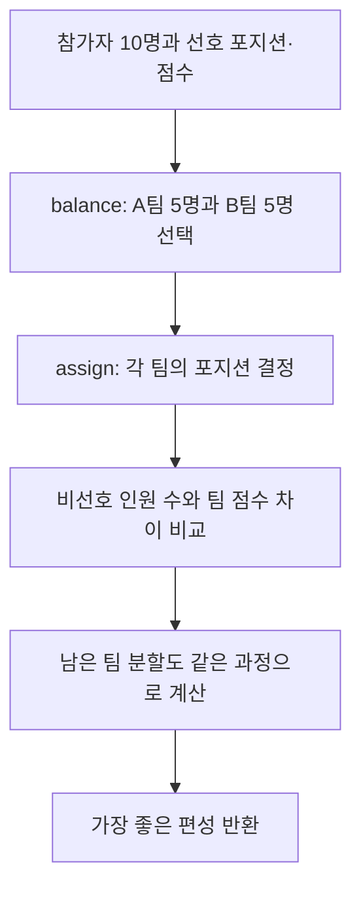

# 팀 편성 코드 설명서 — 개발 지식 없이 이해하기

이 문서는 현재 `TeamBalancer` 코드를 설명합니다. 계산 방식이나 코드를 변경하는 제안서는 아닙니다.

앞부분은 사람과 역할을 배치하는 이야기로 읽고, 뒷부분은 실제 코드와 비교하며 읽으면 됩니다. 처음부터 연산 기호를 외울 필요는 없습니다.

## 1. 이 프로그램이 결정하는 두 가지

참가자 10명이 모였다고 생각해 봅시다. 프로그램은 두 가지를 결정해야 합니다.

1. **누가 같은 팀인가?** — A팀 5명과 B팀 5명을 정합니다.
2. **각자 무슨 역할인가?** — 팀 안에서 탑·정글 등의 포지션을 정합니다.

첫 번째는 `balance()`, 두 번째는 `assign()`이 담당합니다. 괄호가 붙은 이름은 프로그램 안에서 특정 일을 수행하는 작업의 이름입니다. 개발에서는 이런 작업을 **메서드**라고 부릅니다.



이 미리보기는 DB에 경기 기록을 저장하지 않습니다. 실제 경기 기록 확정은 별도 `POST /api/matches` 기능이 담당합니다.

## 2. 프로그램에서 말하는 가장 좋은 편성

비교 순서는 다음과 같습니다.

1. 선호하지 않는 포지션에 배정되는 사람이 가장 적어야 합니다.
2. 그 인원 수가 같다면 두 팀의 점수 차이가 가장 작아야 합니다.

| 편성 | 비선호 배정 인원 | 팀 점수 차이 | 판단 |
| --- | ---: | ---: | --- |
| 가 | 0명 | 200점 | 아래 나보다 우선 |
| 나 | 1명 | 0점 | 점수가 같아도 비선호 배정이 있어 후순위 |
| 다 | 0명 | 100점 | 가와 비선호 인원이 같고 점수 차이가 더 작아 최종 선택 |

선호 포지션을 여러 개 고른 사람은 그중 어느 역할에 배정돼도 선호를 충족합니다. 첫 번째로 고른 포지션을 더 우대하는 규칙은 없습니다.

`allowNonPreferredPositions`는 “선호 편성이 불가능하면 비선호 배정도 허용하겠다”는 요청입니다. 기본값은 허용하지 않음입니다.

- 허용하지 않음: 최적 결과에도 비선호 배정이 필요하면 요청을 거절합니다.
- 허용함: 비선호 배정 인원이 가장 적은 결과를 반환하고 경고를 제공합니다.

**허용한다고 해서 점수 균형을 위해 선호 포지션을 포기하는 것은 아닙니다.** 위의 비교 순서는 그대로입니다.

## 3. 126가지는 역할 배정 수가 아니라 팀을 나누는 수

10명 중 A팀에 들어갈 5명을 고르는 방법은 252가지입니다.

그러나 다음 두 결과는 같은 사람끼리 경기하므로 같은 편성으로 봅니다.

```text
A팀: 민수·지수·현우·수진·태호 / B팀: 나머지 5명
A팀: 나머지 5명 / B팀: 민수·지수·현우·수진·태호
```

팀 이름만 뒤집힌 결과를 제외하면 `252 ÷ 2 = 126가지`가 됩니다. 포지션은 아직 정하지 않은 숫자입니다.

코드는 특정 참가자 한 명을 항상 A팀에 포함해서 이런 중복을 제외합니다. 이는 팀 구성의 가능성을 줄이는 것이 아니라, A/B 이름만 바뀐 동일한 경기를 한 번만 계산하는 방법입니다.

롤이든 오버워치든 참가자가 10명이고 두 팀이 5명씩이라면 팀 분할 수는 같습니다.

## 4. assign은 팀원 5명이 정해진 뒤 역할을 정한다

한 팀의 팀원이 정해지면 채워야 할 역할 자리를 준비합니다. 코드의 `slots`는 이 역할 자리 목록입니다.

| 게임 | 첫째 자리 | 둘째 자리 | 셋째 자리 | 넷째 자리 | 다섯째 자리 |
| --- | --- | --- | --- | --- | --- |
| 롤 | 탑 | 정글 | 미드 | 원딜 | 서포터 |
| 오버워치 | 탱커 | 딜러 | 딜러 | 서포터 | 서포터 |

오버워치의 딜러 두 자리는 같은 역할이지만 각각 한 사람이 들어가는 별도의 자리입니다.

`assign()`은 정해진 5명을 이 자리에 한 명씩 배정합니다. 이미 정해진 팀원을 다른 팀으로 보내지는 않습니다.

### 한 명씩 바로 결정하면 생길 수 있는 문제

설명을 위해 팀원과 역할을 두 개로 줄여 봅시다. 실제 서비스는 여전히 팀당 5명입니다.

| 참가자 | 선호 역할 |
| --- | --- |
| 민수 | 탑, 정글 |
| 지수 | 탑 |

민수부터 보고 “탑을 선호하니 탑에 넣자”라고 바로 결정하면, 지수는 선호하지 않는 정글에 배정됩니다.

하지만 두 배정을 비교하면 더 좋은 결과를 찾을 수 있습니다.

| 탑 | 정글 | 비선호 인원 |
| --- | --- | ---: |
| 민수 | 지수 | 1명 |
| 지수 | 민수 | 0명 |

`assign()`은 이런 조합을 고려해서 가장 적은 비선호 인원을 찾습니다.

## 5. 계산 결과를 메모하는 방식: 동적 계획법

동적 계획법은 여기서 **작은 배정 문제의 답을 적어 두고, 더 큰 배정 문제를 풀 때 재사용하는 방법**입니다.

예를 들어 민수·지수·현우를 탑·정글·미드에 배정한다고 생각해 봅시다.

“현우를 마지막 자리인 미드에 넣으면 어떨까?”를 판단하려면 다음 두 정보를 합치면 됩니다.

```text
민수·지수를 탑·정글에 배정하는 최소 비선호 인원
+
현우를 미드에 넣을 때의 비선호 여부
```

민수·지수의 최적 배정을 앞에서 계산해 메모했다면, 처음부터 다시 계산할 필요가 없습니다.

중요한 점은 메모가 “민수는 무조건 탑”처럼 사람별 결정을 고정하지 않는다는 것입니다. **선택된 사람들을 앞쪽 역할 자리에 배정하는 최소 비용**을 기억합니다.

현재 코드에서 비용은 돈이나 처리 시간이 아니라 **비선호 배정 인원 수**입니다.

## 6. 선택한 사람을 표시하는 방식: 비트마스크

종이에 참가자마다 체크박스를 그릴 수 있습니다.

```text
민수 [선택]  지수 [미선택]  현우 [선택]
```

코드는 이 체크표를 숫자 하나로 보관합니다. 그 방법을 **비트마스크**라고 부릅니다.

각 사람에게 한 자리를 배정하고, 선택이면 1, 미선택이면 0으로 표시합니다. 이 코드에서는 오른쪽부터 사람 번호가 증가합니다.

```text
사람: 현우 지수 민수
표시:   1    0    1
```

`101`은 민수와 현우를 선택했다는 뜻입니다. 문서의 이 표시는 이진수입니다. 일상에서 사용하는 숫자로는 5입니다.

| 사람 번호 | 이름 | 이진수에서의 자리 |
| --- | --- | --- |
| 0번 | 민수 | 맨 오른쪽 |
| 1번 | 지수 | 오른쪽에서 두 번째 |
| 2번 | 현우 | 오른쪽에서 세 번째 |

사람 번호는 리스트 안에서의 순서입니다. DB의 참가자 ID나 점수가 아닙니다.

| 이진수 표시 | 일상적인 숫자 | 선택한 사람 |
| --- | ---: | --- |
| `000` | 0 | 없음 |
| `001` | 1 | 민수 |
| `010` | 2 | 지수 |
| `011` | 3 | 민수, 지수 |
| `100` | 4 | 현우 |
| `101` | 5 | 민수, 현우 |
| `110` | 6 | 지수, 현우 |
| `111` | 7 | 모두 |

`mask`라는 변수는 이 체크표를 보관하는 숫자입니다.

### 같은 mask지만 두 메서드의 뜻은 다르다

| 사용 위치 | 1의 의미 | 0의 의미 |
| --- | --- | --- |
| `balance()` | A팀에 들어감 | B팀에 들어감 |
| `assign()` | 현재 배정 계산에 포함됨 | 현재 배정 계산에 포함되지 않음 |

특히 `assign()`의 체크표는 **누가 어느 포지션인지까지 표현하지 않습니다.** 누구를 배정하는 문제인지 표시하고, 실제 배정은 별도 메모로 복원합니다.

## 7. 연산 기호를 체크표 조작으로 읽기

### 1 << index: 확인할 사람의 자리 찾기

`<<`는 비트를 왼쪽으로 이동하는 기호입니다.

```text
1 << 0 → 001 → 민수 자리
1 << 1 → 010 → 지수 자리
1 << 2 → 100 → 현우 자리
```

`1 << 사람 번호`를 “이 사람의 체크박스 위치”라고 읽으면 됩니다.

`1 << 5`는 32입니다. 5명을 각각 선택하거나 선택하지 않는 체크표가 `2 × 2 × 2 × 2 × 2 = 32개`라는 의미로도 사용합니다.

### &: 이 사람이 체크됐는지 확인

`&`는 양쪽에서 모두 1인 자리만 남깁니다.

```text
현재 체크표: 101
지수의 자리: 010
결과:        000 → 지수는 선택되지 않음

현재 체크표: 101
현우의 자리: 100
결과:        100 → 현우는 선택됨
```

따라서 `(mask & (1 << index)) != 0`은 “이 사람이 선택돼 있는가?”입니다.

### ^: 체크 상태 뒤집기

`^`는 지정한 자리의 0과 1을 뒤집습니다.

```text
현재 체크표: 101
현우의 자리: 100
결과:        001 → 현우를 제외하고 민수만 남김
```

이 코드에서는 **이미 선택된 사람에 대해서만** 사용하므로, 선택된 사람 한 명을 제외하는 용도로 읽으면 됩니다. 아무 사람에게나 적용하면 미선택을 선택으로 바꿀 수도 있습니다.

### Integer.bitCount(mask): 체크된 사람 수

```text
001 → 1명
101 → 2명
111 → 3명
```

### ? 값1 : 값2: 조건에 따라 두 값 중 선택

```java
선호하는가 ? 0 : 1
```

선호하면 0을, 선호하지 않으면 1을 사용한다는 뜻입니다.

## 8. balance 코드를 순서대로 읽기

### 8.1 입력 확인과 계산 순서 준비

```java
validate(game, candidates);
```

게임·참가자 정보와 선호 포지션이 올바른지 확인합니다. 상세 검증은 11절에 있습니다.

```java
List<PreviewCandidate> ordered = candidates.stream()
        .sorted(Comparator.comparing(PreviewCandidate::participantId)).toList();
```

참가자 ID인 UUID순으로 목록을 정렬합니다. UUID는 사람마다 부여한 식별 번호입니다. 이름이나 실력순으로 정렬하는 것이 아닙니다.

같은 사람과 정보라면 요청에서 나열한 순서가 달라도 같은 순서로 탐색합니다. 비선호 인원과 점수 차이가 모두 같은 편성이 여러 개 있을 때 결과가 흔들리지 않도록 합니다.

```java
List<Position> slots = slots(game);
```

게임별로 채워야 할 역할 자리 5개를 준비합니다.

```java
TeamAssignment bestA = null;
TeamAssignment bestB = null;
int bestViolations = Integer.MAX_VALUE;
long bestDifference = Long.MAX_VALUE;
```

지금까지 찾은 최적 A/B팀과 비교 기준을 적을 공간입니다.

- `null`: 아직 최적 팀을 찾지 않았음.
- `MAX_VALUE`: 해당 숫자 타입에서 표현할 수 있는 가장 큰 값. 첫 결과가 반드시 이보다 좋은 결과로 선택되도록 초기값으로 사용함.
- `int`: 일반 정수. 인원 수 등에 사용함.
- `long`: 더 큰 정수. 여러 사람의 점수를 합칠 때 범위 초과를 피하기 위해 사용함.

### 8.2 팀 분할 후보 탐색

```java
for (int mask = 1; mask < (1 << ordered.size()); mask += 2) {
```

10명 체크표 중 홀수인 숫자만 차례로 봅니다.

- `mask = 1`: 맨 오른쪽 사람만 체크한 상태에서 시작.
- `1 << ordered.size()`: 10명이므로 1024. 0부터 1023까지가 가능한 전체 체크표임.
- `mask += 2`: 1, 3, 5, 7처럼 홀수만 확인. 맨 오른쪽 사람을 항상 A팀에 포함함.

```java
if (Integer.bitCount(mask) != 5) continue;
```

A팀이 정확히 5명인 체크표만 사용합니다. `continue`는 현재 후보를 건너뛰고 다음 후보로 이동한다는 뜻입니다. 이 조건을 통과하는 분할이 126개입니다.

```java
List<PreviewCandidate> teamA = new ArrayList<>();
List<PreviewCandidate> teamB = new ArrayList<>();
```

이번 후보의 A팀과 B팀 명단을 준비합니다.

```java
for (int index = 0; index < ordered.size(); index++) {
    ((mask & (1 << index)) != 0 ? teamA : teamB).add(ordered.get(index));
}
```

참가자 한 명씩 체크표를 확인합니다. 체크됐으면 A팀, 아니면 B팀 명단에 추가합니다. `index`는 현재 확인 중인 사람 번호입니다.

### 8.3 역할 배정과 후보 비교

```java
TeamAssignment assignmentA = assign(teamA, slots);
TeamAssignment assignmentB = assign(teamB, slots);
```

각 팀의 최적 역할 배정을 계산합니다. `TeamAssignment`는 그 계산 결과를 묶은 자료입니다.

```java
int violations = assignmentA.violations() + assignmentB.violations();
long difference = Math.abs(assignmentA.totalScore() - assignmentB.totalScore());
```

두 팀의 비선호 인원을 합치고 팀 점수 차이를 구합니다. `Math.abs()`는 음수 부호를 없애므로, 어느 팀의 점수가 더 높든 차이는 음수가 되지 않습니다.

```java
if (violations < bestViolations || (violations == bestViolations && difference < bestDifference)) {
    bestA = assignmentA;
    bestB = assignmentB;
    bestViolations = violations;
    bestDifference = difference;
}
```

`||`는 “또는”, `&&`는 “그리고”입니다. 이 조건을 문장으로 읽으면 다음과 같습니다.

> 비선호 인원이 더 적거나, 비선호 인원이 같으면서 점수 차이가 더 작으면 최적 결과를 갱신한다.

두 기준이 모두 같으면 기존 결과를 유지합니다. 반복문이 끝나면 126개 중 최적 결과가 남습니다.

### 8.4 허용 여부 확인과 결과 만들기

```java
if (bestViolations > 0 && !allowNonPreferredPositions) {
    throw new BusinessException(ErrorCode.PREFERRED_POSITION_UNAVAILABLE);
}
```

`!`는 “아님”입니다. 최적 결과에도 비선호가 필요한데 이를 허용하지 않았다면, 정상 결과 대신 편성이 불가능하다는 오류를 전달합니다.

```java
List<MatchParticipant> result = new ArrayList<>();
append(result, bestA, slots, MatchParticipant.Team.A);
append(result, bestB, slots, MatchParticipant.Team.B);
return List.copyOf(result);
```

A/B팀 결과를 합쳐 반환합니다. `List.copyOf()`는 반환 목록 자체를 외부에서 추가·삭제·교체할 수 없게 만듭니다. 여기서 DB 저장을 수행하지는 않습니다.

## 9. assign 코드를 순서대로 읽기

### 9.1 메모장 준비

```java
int states = 1 << candidates.size();
int[] costs = new int[states];
int[] chosen = new int[states];
Arrays.fill(costs, Integer.MAX_VALUE);
costs[0] = 0;
```

팀원 5명의 체크표는 32개입니다. 체크표마다 메모할 수 있도록 숫자 칸이 32개인 두 메모장을 만듭니다. 개발에서는 이런 연속된 칸을 **배열**이라고 부릅니다.

| 메모장 | 저장할 내용 |
| --- | --- |
| `costs` | 선택된 사람들을 앞쪽 역할 자리에 배정한 최소 비선호 인원 |
| `chosen` | 그 결과에서 마지막 역할에 배정한 사람 번호 |

`Arrays.fill()`은 모든 비용 칸을 가장 큰 값으로 채웁니다. 아직 계산하지 않았다는 표시입니다.

`costs[0] = 0`은 “아무도 배정하지 않았으면 비선호 인원도 0명”이라는 출발점입니다.

### 9.2 현재 문제의 마지막 역할 결정

```java
for (int mask = 1; mask < states; mask++) {
    Position position = slots.get(Integer.bitCount(mask) - 1);
```

각 체크표를 차례로 계산합니다. 체크된 사람이 몇 명인지 보고, 그 사람들을 채울 앞쪽 자리 중 마지막 역할을 찾습니다.

롤에서 체크된 사람이 2명이면 탑·정글을 채우는 문제이고, 이번에 후보를 검토할 마지막 역할은 정글입니다.

`- 1`은 목록 번호가 0부터 시작하기 때문입니다. 2명의 마지막 자리 번호는 1입니다.

### 9.3 마지막 역할에 넣을 사람을 각각 검토

```java
for (int index = 0; index < candidates.size(); index++) {
    if ((mask & (1 << index)) == 0) continue;
```

현재 체크표에 포함된 사람만 마지막 역할 후보로 검토합니다. 포함되지 않은 사람은 건너뜁니다.

```java
int previous = mask ^ (1 << index);
```

현재 후보를 제외한 체크표를 만듭니다. 마지막 역할에 현재 후보를 넣겠다고 가정하면, 나머지 사람들은 앞쪽 역할을 채워야 합니다.

```java
int cost = costs[previous] + (candidates.get(index).preferredPositions().contains(position) ? 0 : 1);
```

“나머지 사람들의 최소 비선호 인원”에 “현재 사람의 배정이 비선호인가?”를 더합니다.

- `costs[previous]`: 이미 메모한 작은 문제의 답.
- `preferredPositions().contains(position)`: 이 사람이 현재 역할을 선호하는지 확인.
- `? 0 : 1`: 선호면 0, 비선호면 1을 더함.

`previous`는 현재 숫자에서 체크된 자리 하나를 제거했으므로 현재 `mask`보다 작은 숫자입니다. 따라서 앞선 반복에서 이미 계산했습니다.

```java
if (cost < costs[mask]) {
    costs[mask] = cost;
    chosen[mask] = index;
}
```

더 좋은 배정이면 비용과 마지막 사람을 기록합니다. 비용이 같으면 기존 선택을 유지합니다.

### 9.4 왜 마지막 사람만 적어도 되는가?

선택된 5명에서 마지막 사람을 알면, 그 사람을 제외한 4명 체크표를 알 수 있습니다. 그 체크표에도 마지막 사람이 기록돼 있습니다.

```text
5명 체크표 → 마지막 사람 확인 → 그 사람 제외
4명 체크표 → 마지막 사람 확인 → 그 사람 제외
3명 체크표 → 같은 과정
...
```

이 연결을 따라가면 전체 배정을 되찾을 수 있습니다. 그래서 모든 칸에 완성된 배정 명단을 복사해 둘 필요가 없습니다.

### 9.5 실제 역할 배정 복원

```java
int[] assignments = new int[slots.size()];
int mask = states - 1;
```

역할별 담당자를 기록할 메모장을 만듭니다. 5명 전체가 체크된 마지막 상태 `11111`에서 시작합니다.

`assignments[역할 번호]`에는 그 역할에 들어갈 사람 번호를 기록합니다.

```java
for (int slot = slots.size() - 1; slot >= 0; slot--) {
    assignments[slot] = chosen[mask];
    mask ^= 1 << chosen[mask];
}
```

마지막 역할부터 거꾸로 확인합니다.

1. 현재 체크표의 마지막 사람을 해당 역할 담당자로 기록합니다.
2. 그 사람을 체크표에서 제외합니다.
3. 앞쪽 역할로 이동해 반복합니다.

롤에서는 서포터 → 원딜 → 미드 → 정글 → 탑 순서로 복원합니다.

### 9.6 계산 결과 묶어서 반환

```java
return new TeamAssignment(candidates, assignments, costs[states - 1],
        candidates.stream().mapToLong(PreviewCandidate::score).sum());
```

팀원 명단, 역할별 담당자 번호, 전체 5명의 최소 비선호 인원, 팀 총점을 반환합니다. 팀원은 이미 정해졌으므로 역할을 어떻게 배정하든 이 팀의 점수 합계는 같습니다.

## 10. 세 사람의 계산을 끝까지 따라가기

아래는 이해를 위한 축소 예시입니다. 실제 API가 3명을 받는다는 뜻은 아닙니다.

| 사람 번호 | 이름 | 선호 역할 |
| --- | --- | --- |
| 0 | 민수 | 탑, 정글 |
| 1 | 지수 | 탑 |
| 2 | 현우 | 미드 |

역할 순서는 탑 → 정글 → 미드입니다.

### 10.1 민수·지수의 배정 메모

| 체크표 | 배정할 사람 | 채울 역할 | 최소 비선호 인원 | 마지막 사람 |
| --- | --- | --- | ---: | --- |
| `001` | 민수 | 탑 | 0 | 민수 |
| `010` | 지수 | 탑 | 0 | 지수 |
| `011` | 민수, 지수 | 탑, 정글 | 0 | 민수 |

`011`에서는 지수를 탑, 민수를 정글에 넣는 것이 최적입니다. 마지막 역할인 정글의 담당자 민수를 기억합니다.

### 10.2 세 명 전체의 마지막 역할을 비교

전체 체크표 `111`의 마지막 역할은 미드입니다.

| 미드에 넣을 사람 | 남은 체크표 | 남은 사람들의 최소 비선호 인원 | 미드 배정의 추가 비선호 | 전체 |
| --- | --- | ---: | ---: | ---: |
| 민수 | `110`: 지수·현우를 탑·정글에 배정 | 1 | 1 | 2 |
| 지수 | `101`: 민수·현우를 탑·정글에 배정 | 1 | 1 | 2 |
| 현우 | `011`: 민수·지수를 탑·정글에 배정 | 0 | 0 | 0 |

현우를 마지막 역할인 미드에 넣으면 비용이 가장 낮으므로 선택합니다.

### 10.3 배정 복원

| 현재 체크표 | 확인할 역할 | 메모한 마지막 사람 | 제외 후 체크표 |
| --- | --- | --- | --- |
| `111` | 미드 | 현우 | `011` |
| `011` | 정글 | 민수 | `010` |
| `010` | 탑 | 지수 | `000` |

최종 결과는 **지수 탑, 민수 정글, 현우 미드**입니다. 세 명 모두 선호 포지션을 충족합니다.

## 11. 나머지 메서드와 자료형

### validate: 계산 가능한 입력인지 확인

참가자가 정확히 10명인지, 참가자 정보나 ID가 null인지, ID가 중복되는지 확인합니다. 문제가 있으면 `INVALID_TEAM_COMPOSITION` 오류를 발생시킵니다.

각 참가자가 선호 포지션을 하나 이상 가졌는지, 그 포지션이 선택한 게임에 속하는지도 확인합니다. 문제가 있으면 `INVALID_PREFERRED_POSITION` 오류를 발생시킵니다.

DB에 실제 존재하고 삭제되지 않은 참가자인지 확인하는 일은 계산 이전에 `TeamPreviewService`가 수행합니다. `TeamBalancer`는 DB를 조회하지 않습니다.

### slots: 게임에 필요한 역할 자리 준비

공유 규칙인 `Game.teamPositions()`를 호출해 역할 5개를 반환합니다. 그 메서드 안에서 `switch`로 게임을 구분합니다. 롤과 오버워치의 역할 수는 4절 표와 같습니다.

### append: 역할 번호와 사람 번호를 실제 결과로 변환

```java
for (int slot = 0; slot < slots.size(); slot++) {
    PreviewCandidate candidate = assignment.candidates().get(assignment.assignments()[slot]);
    result.add(new MatchParticipant(candidate.participantId(), candidate.name(), candidate.score(), slots.get(slot), team));
}
```

역할 자리를 하나씩 확인합니다.

1. `assignments[slot]`에서 이 자리 담당자의 번호를 읽습니다.
2. `candidates` 명단에서 그 번호에 해당하는 참가자를 가져옵니다.
3. 참가자 ID·이름·점수·배정 포지션·A/B팀을 담은 결과 객체를 만듭니다.

`MatchParticipant` 객체를 만드는 것이 DB에 저장하는 것은 아닙니다. 현재 메서드에는 저장 명령이 없습니다.

### TeamAssignment: 한 팀의 계산 결과를 담는 묶음

```java
private record TeamAssignment(List<PreviewCandidate> candidates, int[] assignments, int violations, long totalScore) {
}
```

`record`는 여러 정보를 함께 전달하는 자료형입니다. 여기서는 네 항목을 묶습니다.

| 항목 | 의미 |
| --- | --- |
| `candidates` | 이번 팀의 참가자 명단 |
| `assignments` | 역할 자리마다 배정한 참가자 번호 |
| `violations` | 비선호 배정 인원 수 |
| `totalScore` | 팀 점수 합계 |

`private`이므로 `TeamBalancer` 내부에서만 사용합니다. 별도 DB 테이블이나 HTTP 응답 형식이 아닙니다.

## 12. 자주 헷갈리는 부분

### 32개 상태와 120개 배정은 왜 다른가?

5명 중 누구를 포함하는지 표시하는 체크표는 32개입니다. 반면 5명을 다섯 자리에 순서대로 배치하는 방법은 120가지입니다.

현재 방식은 순서가 다른 모든 배정을 메모하는 대신, 같은 사람 집합을 앞쪽 자리에 배정하는 문제를 하나로 묶고 가장 좋은 결과를 기억합니다. 각 상태에서도 마지막 사람 후보를 여러 명 비교하므로, 계산 전체가 단순히 32번의 연산으로 끝나는 것은 아닙니다.

### 앞쪽 결과 하나만 기억하면 더 좋은 전체 결과를 놓치지 않는가?

이 계산에서는 작은 문제의 사람 집합과 역할 자리가 정해져 있습니다. 비용은 각 사람의 비선호 여부를 합한 값이고, 점수 합계는 포지션 배정에 따라 달라지지 않습니다.

따라서 같은 집합과 같은 역할 자리에 대한 더 나쁜 배정을 보관해도 뒤쪽 결과가 좋아질 이유가 없습니다. 지금의 규칙에서는 최소 비용과 그 선택 경로만 기억해도 됩니다.

향후 “특정 두 사람이 함께 특정 역할을 맡으면 추가 점수를 준다”처럼 규칙을 바꾸면, 이 전제가 유지되는지 다시 검토해야 합니다.

### 현재 코드가 완벽한 편성을 찾으면 일찍 종료하는가?

아닙니다. 현재 `balance()`는 조건을 만족하는 126개 분할을 모두 비교합니다. 선호 위반 0명·점수 차이 0을 찾았을 때 조기 종료하는 개선은 이번 코드에 적용하지 않았습니다.

### 시프트 연산자가 기능에 꼭 필요한가?

아닙니다. 참가자별 선택 여부를 숫자로 보관하기 위한 구현 선택입니다. 일반 목록과 선택 여부 배열, 재귀 탐색으로도 같은 기능을 구현할 수 있습니다.

현재 코드는 작은 집합의 계산 결과를 빠르게 재사용하는 방식을 선택했습니다. 그 대신 비트 표현과 메모 복원을 함께 이해해야 하는 가독성 비용이 있습니다.

### 코드와 대조할 때 무엇부터 보면 좋은가?

먼저 `balance()`를 “팀을 나누고 결과를 비교하는 작업”으로 읽습니다. 다음으로 10절의 세 사람 예시를 따라간 뒤 `assign()`을 봅니다.

헷갈릴 때는 다음 네 뜻을 먼저 확인하면 됩니다.

```text
mask        = 현재 계산에 포함한 사람들의 체크표
costs       = 그 사람들을 앞쪽 자리에 넣는 최소 비선호 인원 메모
chosen      = 그 최솟값을 만들 때 마지막 자리에 넣은 사람 메모
assignments = 메모를 따라 복원한 최종 역할별 담당자 번호
```

## 13. 관련 코드 이름

| 클래스 | 담당하는 일 |
| --- | --- |
| `TeamPreviewApi` | Swagger API 설명 |
| `TeamPreviewController` | 요청 수신·검증 실행·HTTP 응답 |
| `TeamPreviewService` | 활성 참가자·프로필 조회, 계산 입력과 응답 준비 |
| `TeamBalancer` | 팀 분할·포지션 배정·최적 결과 선택 |
| `PreviewCandidate` | 계산에 필요한 참가자 정보 |
| `TeamPreviewResponse` | 화면에 전달할 팀·점수·경고·버전 정보 |

`TeamBalancerTests`는 별도의 완전 탐색 계산과 비교해 현재 알고리즘의 최적 결과를 확인합니다. `TeamPreviewApiTests`는 실제 DB와 HTTP 요청 처리 흐름을 검증합니다.
